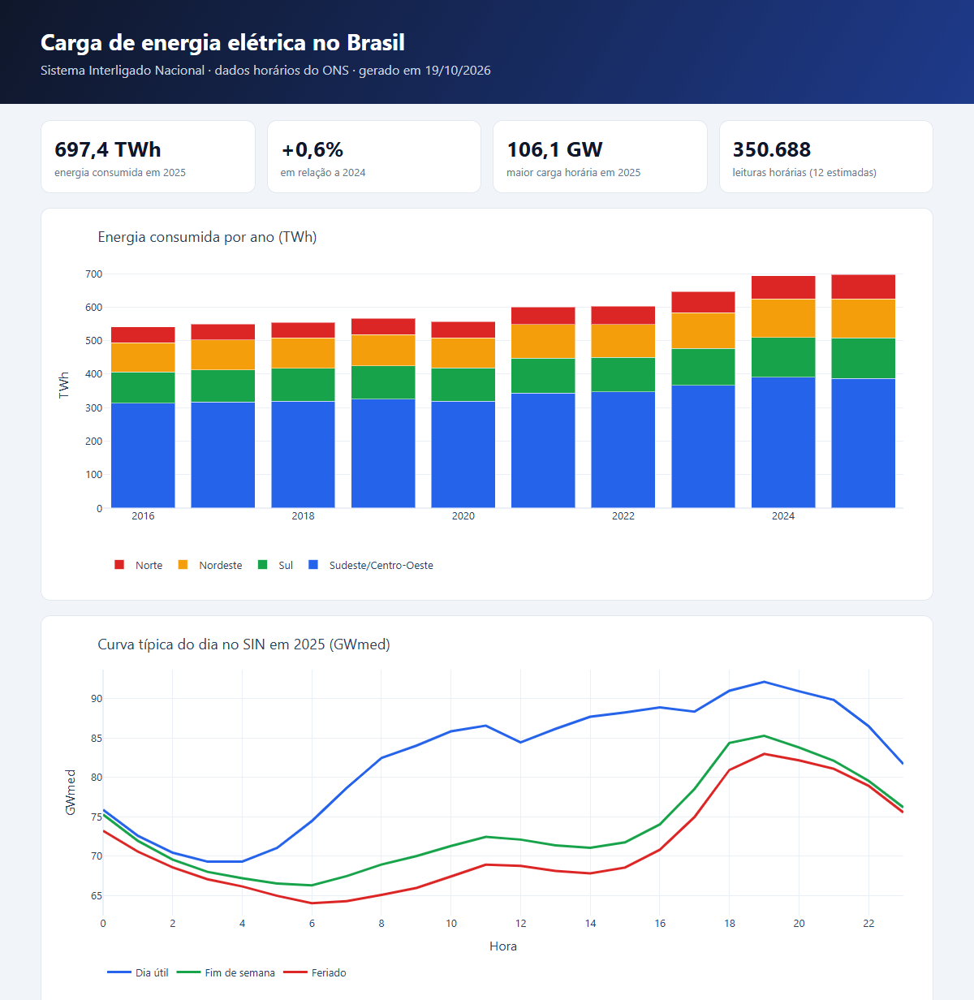
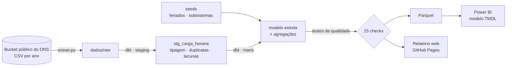

# Pipeline de Dados: Carga de Energia do Brasil


Pipeline de **engenharia de dados** que coleta a carga de energia elétrica hora a hora do Sistema Interligado Nacional (dados abertos do ONS), trata e testa a qualidade com **dbt + DuckDB**, monta um **modelo estrela** e entrega o resultado em dois formatos:

- um **modelo do Power BI** (medidas DAX e relacionamentos), lendo os dados direto do GitHub
- um **relatório web** publicado e atualizado sozinho todo mês: **[abrir o relatório](https://kauan-v-marques.github.io/pipeline-energia-ons/)**



## Arquitetura



| Camada | O que faz |
|---|---|
| **Extração** | Baixa 10 anos de CSV, confere o layout de cada arquivo e grava de forma atômica, sem deixar arquivo pela metade. O ano corrente é sempre baixado de novo |
| **Staging** | Tipa as colunas, junta horas duplicadas e **preenche horas sem medição** com a média das vizinhas, marcando cada uma como estimada |
| **Marts** | Modelo estrela: `fato_carga_horaria`, `dim_calendario` (com feriados nacionais e tipo de dia) e `dim_subsistema`. Também gera agregações de energia mensal com crescimento anual, curva típica do dia, carga do SIN e picos |
| **Testes** | 25 checagens do dbt: unicidade, nulos, valores aceitos, integridade referencial, **todos os dias com 96 leituras**, carga plausível e limite de horas estimadas |
| **Entrega** | Parquet para o Power BI, relatório HTML com Plotly, e execução agendada mensal no GitHub Actions que publica o relatório e salva os dados novos |

## O que os testes de qualidade encontraram

Os dados do ONS são bons, mas não perfeitos:

- **11 horas sem valor** nos arquivos de 2016 a 2018
- **Uma carga igual a zero em 04/11/2018, à 0h, no subsistema Sul.** Foi a madrugada em que começou o **horário de verão**: os relógios pularam da meia-noite direto para 1h, então essa hora "não existiu". O teste `assert_carga_plausivel` barrou o pipeline nesse ponto

As duas situações agora são tratadas na staging: carga ≤ 0 é tratada como hora sem medição, e a hora é estimada pelas vizinhas. Ao todo são **12 horas estimadas em 350.688 leituras** (0,003%), e um teste garante que esse número continue baixo.

## Alguns resultados

- **Carga de 2025:** 697 TWh, 29% acima de 2016
- **Pico histórico:** 106 GW em 26/02/2025, às 14h, impulsionado pelo calor e pelo ar-condicionado
- **Pandemia:** em abril de 2020 a carga ficou 12,7% abaixo de abril de 2019 (maio −11%, junho −4%) e só voltou ao normal em julho
- **Feriados:** às 14h, a carga de um feriado fica 22,7% abaixo da de um dia útil. No fim de semana a queda é de 19%

## Power BI

O modelo semântico está em [`powerbi/`](powerbi), no formato **TMDL** (o formato textual oficial do Power BI, que funciona bem com Git):

| Tabela | Conteúdo |
|---|---|
| `fCargaHoraria` | 350 mil leituras (data, hora, subsistema, carga, se foi estimada) |
| `dCalendario` | Calendário marcado como tabela de datas, com feriados e tipo de dia |
| `dSubsistema` | Norte, Nordeste, Sul e Sudeste/Centro-Oeste |

**Medidas DAX:** `Energia (GWh)`, `Carga média (MWmed)`, `Demanda máxima (MW)`, `Fator de carga`, `Energia ano anterior (GWh)`, `Crescimento anual %` (com `SAMEPERIODLASTYEAR`), `Participação %` e `Horas estimadas`.

Os dados vêm direto dos arquivos Parquet deste repositório, pelo parâmetro `UrlDados`. Não é preciso configurar caminho nenhum.

### Como abrir

1. **Projeto PBIP:** abra `powerbi/EnergiaONS.pbip` no Power BI Desktop e clique em **Atualizar**.
2. **Se o PBIP não abrir na sua versão:**
   - crie um relatório em branco e entre na **Exibição TMDL**, no menu da esquerda
   - cole o conteúdo de [`powerbi/script-tmdl-view.tmdl`](powerbi/script-tmdl-view.tmdl) e clique em **Aplicar**
   - depois clique em **Atualizar**

Sugestão de painel:
- cartões com `Energia (GWh)`, `Crescimento anual %`, `Demanda máxima (MW)` e `Fator de carga`
- colunas empilhadas de energia por ano e região
- linha da carga média por hora, separada por tipo de dia
- matriz de mês × hora com formatação condicional

O modelo é validado a cada push com a biblioteca oficial da Microsoft para modelos tabulares (TOM), em [`powerbi/validar`](powerbi/validar).

## Como rodar

```bash
python -m venv .venv
source .venv/bin/activate          # Windows: .venv\Scripts\activate
pip install -e ".[dev]"
python -m pipeline                 # extração + dbt build + Parquet + relatório
```

O banco DuckDB fica em `dados/energia.duckdb`, e o relatório em `site/index.html`. Para explorar os modelos:

```bash
cd dbt
dbt docs generate --profiles-dir . && dbt docs serve --profiles-dir .
```

## Testes

- **Python:** cálculo da Páscoa e dos feriados móveis, a regra do Dia da Consciência Negra (nacional desde 2024), e a extração com um servidor falso (download, cache e layout inesperado)
- **dbt:** 25 nós entre modelos e testes de dados
- **Power BI:** validação do TMDL e conferência de que o script da Exibição TMDL está em dia com o modelo

## Créditos dos dados

[Curva de Carga Horária](https://dados.ons.org.br/dataset/curva-carga), do Operador Nacional do Sistema Elétrico (ONS), sob a licença Creative Commons Atribuição (CC-BY).

---

<details>
<summary>English</summary>

### Data Pipeline: Brazil's Electricity Load

An **ELT pipeline** over 10 years of hourly load data from Brazil's grid operator (ONS, CC-BY): Python extraction, **dbt + DuckDB** staging and star-schema marts, 25 data-quality checks (which caught a zero reading on the 2018 daylight-saving transition, now handled as a gap), Parquet exports feeding a **Power BI semantic model in TMDL** (DAX measures, validated with Microsoft's TOM library in CI) and a Plotly web report published on GitHub Pages and refreshed monthly by a scheduled GitHub Actions run.

</details>
